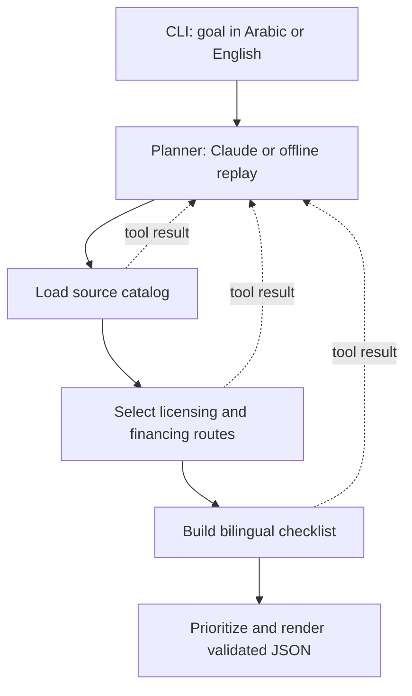

# Architecture

The planner executes four bounded tool calls. Local code controls the sources, translated text and SDG tags. Claude receives the selected goal, locale, and curated tool results and can select a first item from the checklist. The offline replay sends canned tool calls through the same dispatcher and preserves catalog order. The output is validated by Pydantic. Neither mode needs applicant records.
