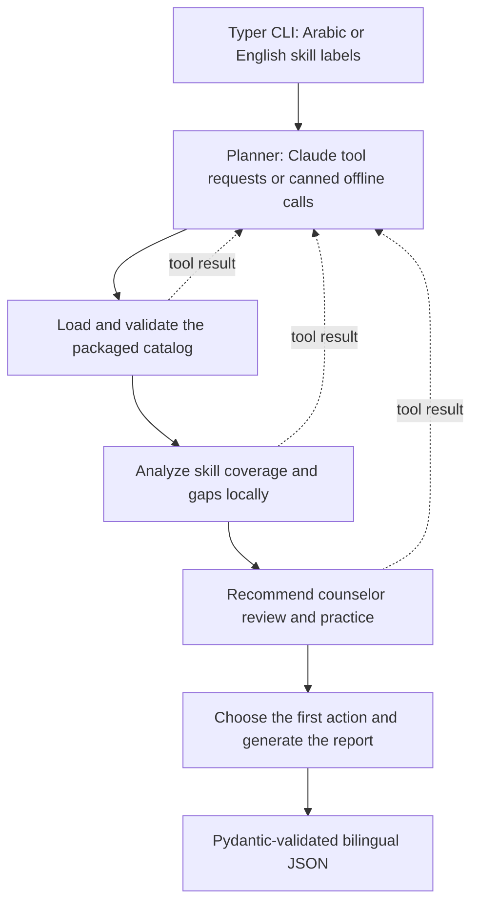

# Architecture

A fixed four-stage plan bounds the number of calls. In live mode Claude emits one tool call per stage and uses preceding tool results to prioritize a first action. The SDK conversation pairs each executed intermediate tool call with its result. The final tool returns the validated report directly. Local Python holds skill labels, computes coverage, generates grounded recommendations, and validates the chosen action index. Raw input labels stay local. Claude receives the requested report language, synthetic catalog metadata, derived matches and recommendations.

The mock replays canned tool-call messages through the same dispatcher with no SDK client or network calls. It prioritizes the first recommendation generated by the recommender. Coverage is the share of role requirements matched, and ties are resolved by matched-skill count and then role ID. Zero-overlap roles are omitted. A no-match report prompts counselor review rather than suggesting an unrelated role.
